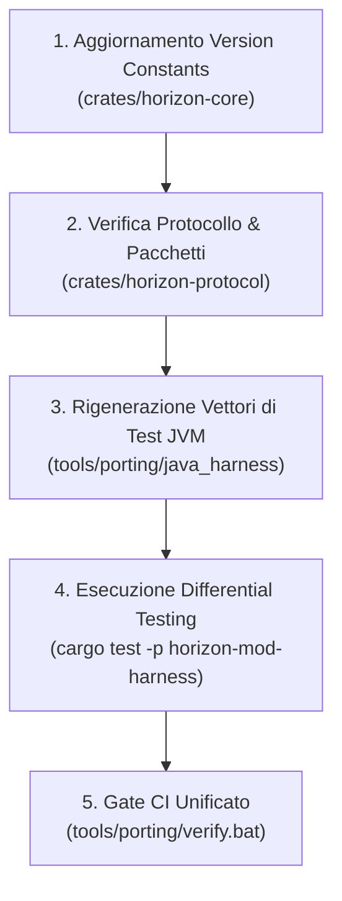

# Procedura Operativa di Version Bump per Horizon e Mod Pilota

*Generato in Fase 6 (Scala) · Data: 2026-10-30*  
*Definisce il protocollo standard per l'aggiornamento della versione di Minecraft e dei mappings.*

---

## 1. Obiettivo

Quando Horizon avanza di versione Minecraft (ad esempio da `26.3` a una versione successiva):
1. I pacchetti di rete del protocollo vanilla (`crates/horizon-protocol`) possono cambiare ID o layout.
2. I mappings Mojmap possono modificare nomi di metodi o campi interni.
3. Le firme dell'API (`crates/horizon-mod-api`) e dei crate mod (`crates/mods/*`) devono essere convalidate sistematicamente.

---

## 2. Checklist Operativa di Bump



### Passo 1: Aggiornamento Costanti di Versione
- Verificare in [`crates/horizon-core/src/version.rs`](../../crates/horizon-core/src/version.rs):
  - `MINECRAFT_VERSION`
  - `PROTOCOL_VERSION`
  - `DATA_VERSION`
- Aggiornare ADR-002 in [`docs/porting/DECISIONS.md`](DECISIONS.md) annotando il cambio di versione e motivazione.

### Passo 2: Aggiornamento Ingestion e Mappings
- Se i sorgenti Java della mod sono legati a una nuova versione di Fabric:
  ```bash
  tools/porting/horizon-port ingest <repo_url_nuovo_tag> --name <mod>
  ```
- Verificare se il manifest rileva nuovi mixin o breaking changes nei pacchetti custom.

### Passo 3: Rigenerazione dei Vettori Golden JVM
- Ricompilare ed eseguire l'harness Java con la nuova JVM/classpath:
  ```bash
  javac tools/porting/java_harness/TestVectorGenerator.java -d tools/porting/java_harness/bin
  java -cp tools/porting/java_harness/bin tools.porting.TestVectorGenerator testdata
  ```

### Passo 4: Esecuzione Gate CI
- Eseguire lo script di verifica gate:
  ```bash
  tools/porting/verify.bat
  ```
- Se si verificano divergenze:
  - Se è cambiata la semantica vanilla di un tipo (`BlockPos`, `VarInt`): aggiornare `horizon-mod-api`.
  - Se è cambiata una logica interna della mod: aggiornare il modulo corrispondente in `crates/mods/<mod>`.
  - Non silenziare mai i fallimenti: registrare ogni discrepanza in [`docs/porting/API_GAPS.md`](API_GAPS.md) e nel report.

### Passo 5: Registrazione nel Log
- Aggiungere una sezione in [`docs/porting/PORTING_LOG.md`](PORTING_LOG.md) con hash dei commit prima e dopo il bump.

