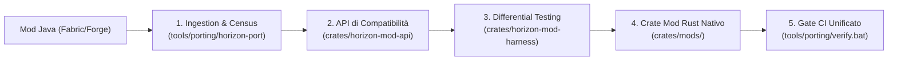

# Guida al Porting di Mod Java per Horizon

*Guida operativa per sviluppatori ed agenti AI (Fase 6) · Data: 2026-10-30*

---

## 1. Architettura del Porting

Il sistema di porting di Horizon non adotta un transpiler magico monolitico, bensì un'architettura **a strati assistita e verificabile**:



---

## 2. Flusso di Lavoro per Aggiungere una Nuova Mod

### Passo 1: Ingestion e Analisi Statica
Esegui la scansione della mod originale tramite la CLI:
```bash
tools/porting/horizon-port ingest https://github.com/autore/mia-mod.git --name mia-mod
```
Verrà generato il file `work/mia-mod/mod-manifest.json` con:
- Elenco classi Java
- Mixin identificati e target vanilla
- Callback Fabric API
- Shader GLSL

### Passo 2: Report di Portabilità (Census)
Controlla la fattibilità ed i rischi architetturali:
```bash
tools/porting/horizon-port census mia-mod
```

### Passo 3: Creazione dello Skeleton Rust
Inizializza il crate nel workspace di Horizon:
```bash
tools/porting/horizon-port skeleton mia-mod
```
Verranno creati automaticamente:
- [`crates/mods/mia-mod/Cargo.toml`](../../crates/mods/)
- [`crates/mods/mia-mod/src/lib.rs`](../../crates/mods/)
- Registrazione del package nel root `Cargo.toml`.

### Passo 4: Implementazione Guidata con Regole Java $\to$ Rust
Rispetta le convenzioni del §10 del Piano:
1. **Tracciabilità:** Ogni funzione portata deve avere un commento:
   ```rust
   // PORT: NomeClasseOriginale#nomeMetodoOriginale
   ```
2. **Niente Panico Silenzioso:** Se una funzione o hook non è ancora implementabile:
   ```rust
   todo!("PORT: NomeClasse#metodo - spiegazione del motivo e dipendenza da API_GAPS")
   ```
3. **Mappatura Tipi:** Consulta sempre [`docs/porting/API.md`](API.md) per mappare:
   - `BlockPos` $\to$ `horizon_mod_api::types::BlockPos`
   - `ChunkPos` $\to$ `horizon_mod_api::types::ChunkPos`
   - Eventi Fabric $\to$ `horizon_mod_api::event::*`
   - Disegno HUD $\to$ `horizon_mod_api::draw::DrawContext`
4. **Parità Aritmetica:**
   - Cast signed $\to$ unsigned: `(v as u32) >> shift`
   - Divisione con arrotondamento euclideo per coordinate: `.div_euclid()` anziché `/`.
   - Wrapping su overflow interi: `.wrapping_add()`, `.wrapping_mul()`.

### Passo 5: Verifica Continua
Prima di qualsiasi commit, fai passare il gate unificato:
```bash
tools/porting/horizon-port verify
```
Il comando verifica:
- Formattazione codice (`cargo fmt --check`)
- Linter senza warning (`cargo clippy -D warnings`)
- Test di unità API e mod
- Suite differenziale Java $\leftrightarrow$ Rust (`difftest`)

